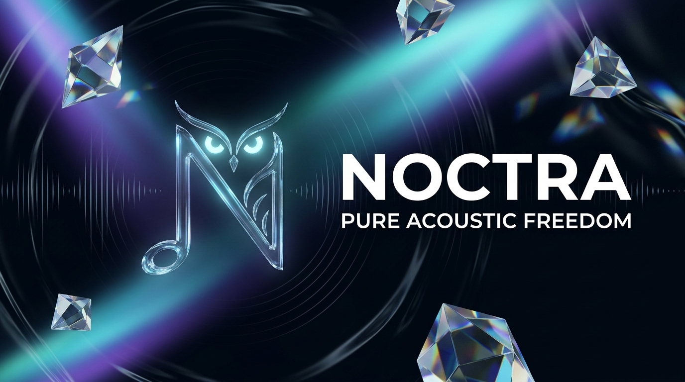
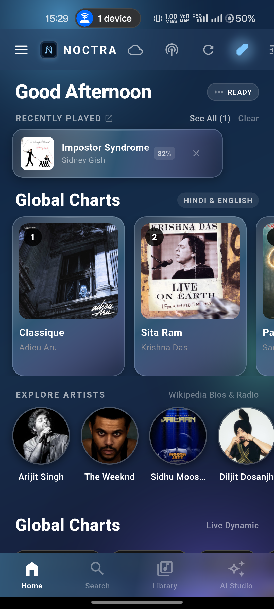
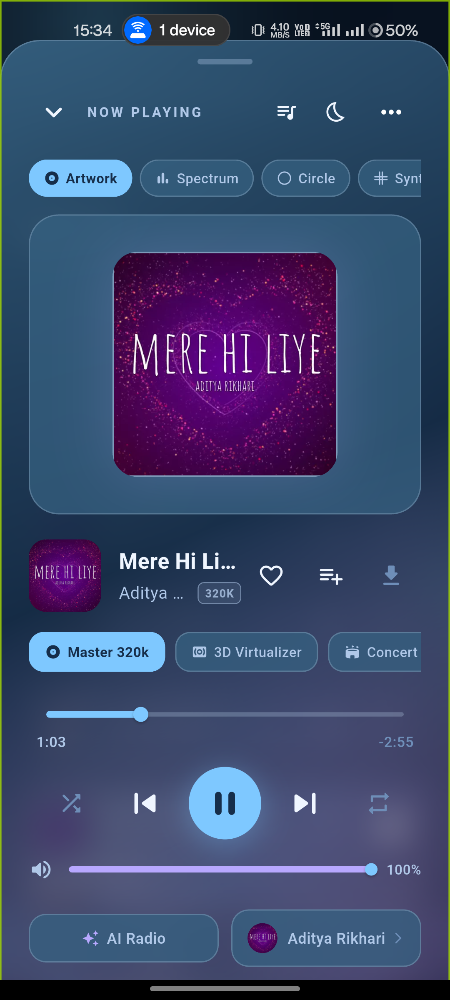
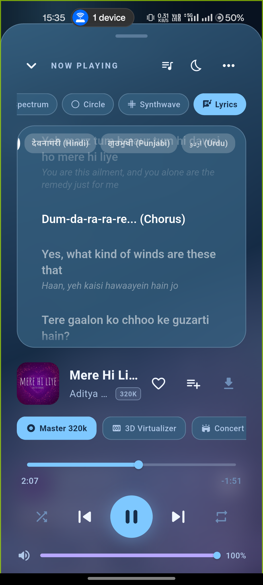
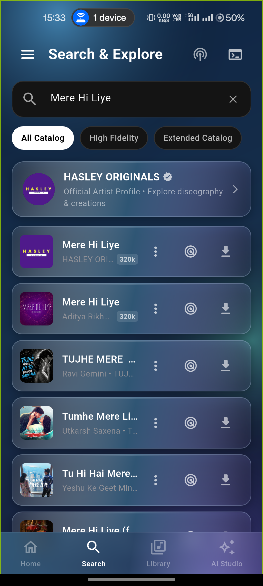
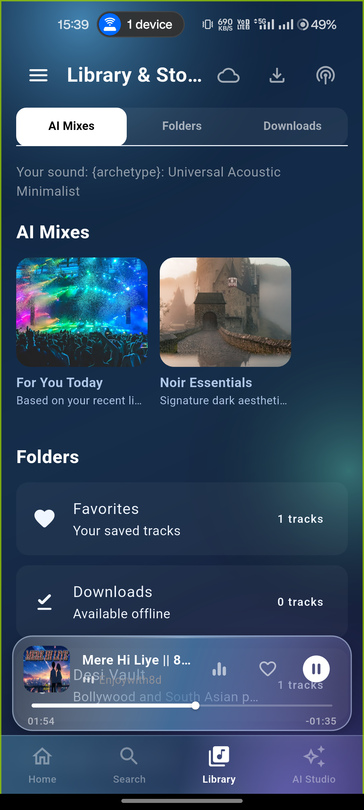
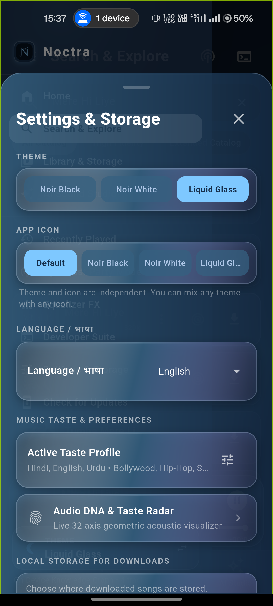

<p align="center">
  
</p>

<h1 align="center">Noctra</h1>

<p align="center">
  <b>Autonomous, Privacy-Sovereign, Audiophile-Grade Cross-Platform Music Client</b><br />
  Lossless 24-bit/192kHz audio streaming &bull; Neural taste vectors &bull; Consolidated bilingual lyrics &bull; Zero telemetry
</p>

<p align="center">
  <a href="https://github.com/Ansh22x/Noctra/releases/latest"></a>
  <a href="LICENSE"></a>
  <a href="SECURITY.md"></a>
  <a href="#privacy-architecture"></a>
  <a href="#streaming--audiophile-playback"></a>
  <a href="#automated-verification"></a>
  <a href="#codebase-architecture"></a>
  <a href="https://flutter.dev"></a>
</p>

<p align="center">
  <a href="https://noctra-audio.netlify.app/"><b>Official Website</b></a> &bull;
  <a href="https://github.com/Ansh22x/Noctra/releases/latest"><b>Downloads & Releases</b></a>
</p>

<p align="center">
  <a href="#overview">Overview</a> &bull;
  <a href="#screenshots">Screenshots</a> &bull;
  <a href="#whats-new-in-v100">What's New</a> &bull;
  <a href="#features">Features</a> &bull;
  <a href="#installation--downloads">Downloads</a> &bull;
  <a href="#architecture">Architecture</a> &bull;
  <a href="#building-from-source">Build from Source</a> &bull;
  <a href="CHANGELOG.md">Changelog</a> &bull;
  <a href="#legal-disclaimer--terms-of-use">Legal Disclaimer</a>
</p>

---

## Overview

**Noctra** is an authentication-less, privacy-sovereign audiophile music streaming platform engineered for **Android, Windows, Linux, and iOS**.

Built with Flutter, Dart, Riverpod, and native platform digital signal processing delegates, Noctra streams pure lossless FLAC audio up to **24-bit/192 kHz**, reconstructs lossy audio to **24-bit studio WAVs** via on-device DSP upscaling, synchronizes bilingual lyrics with Apple Music-style translation subtitles, executes on-device neural recommendations, and packages into native standalone installers (`.exe`, `.deb`, `.apk`, `.ipa`) without user accounts, cloud tracking, or telemetry.

---

## Screenshots

<table align="center">
  <tr>
    <td align="center" width="33%">
      <br />
      <b>Discovery & Trending Feeds</b>
    </td>
    <td align="center" width="33%">
      <br />
      <b>Hi-Res Player & Audio Telemetry</b>
    </td>
    <td align="center" width="33%">
      <br />
      <b>Bilingual Lyrics & Subtitles</b>
    </td>
  </tr>
  <tr>
    <td align="center" width="33%">
      <br />
      <b>Search & Catalog Explorer</b>
    </td>
    <td align="center" width="33%">
      <br />
      <b>Library & Custom Folders</b>
    </td>
    <td align="center" width="33%">
      <br />
      <b>DSP Equalizer & Audio DNA</b>
    </td>
  </tr>
</table>

---

## Table of Contents

- [Overview](#overview)
- [Screenshots](#screenshots)
- [What's New in v1.0.0](#whats-new-in-v100)
- [Features](#features)
  - [Streaming & Audiophile Playback](#streaming--audiophile-playback)
  - [On-Device 24-Bit Audio Upscaler](#on-device-24-bit-audio-upscaler)
  - [Responsive Cross-Platform Shell](#responsive-cross-platform-shell)
  - [Discovery & Neural Taste Engine](#discovery--neural-taste-engine)
  - [Synced Bilingual Lyrics & Transliteration](#synced-bilingual-lyrics--transliteration)
  - [Playlist Management & Universal Transfer](#playlist-management--universal-transfer)
  - [Quad Signature Aesthetic & Material U](#quad-signature-aesthetic--material-u)
- [Installation & Downloads](#installation--downloads)
- [Architecture](#architecture)
- [Building from Source](#building-from-source)
- [Development Team](#development-team)
- [Special Thanks](#special-thanks)
- [Legal Disclaimer & Terms of Use](#legal-disclaimer--terms-of-use)

---

## What's New in v1.0.0

- **Per-Architecture APKs**: every release now ships `arm64-v8a`, `armeabi-v7a`, `x86_64` and `universal` APKs next to the Play `.aab`, all signed with the same certificate so they upgrade over each other.
- **Verifiable updates**: `noctra-update-manifest.json` pins the filename and SHA-256 of each ABI package, and the in-app updater installs the exact build for your device.
- **Automatic Lossless Upscaled Playback**: Cached 24-bit upscaled WAVs are automatically recognized and resolved for bit-perfect local playback over lossy network streams.
- **`24-BIT UPSCALED` Hi-Res Badge**: Player controls now display a gold badge during upscaled playback; tapping navigates directly to the upscaler engine.
- **Immediate Upscale Playback**: Completion sheet features a 1-tap "Play Upscaled Track" primary action.
- **Persistent Transliteration Script**: User-selected scripts in lyrics view (Romanized, Devanagari, Hanzi/Pinyin) persist across track transitions.
- **Visual Contrast & Legibility Overhaul**: Elevated secondary and tertiary text contrast across Noir Black, Noir White, Liquid Glass, and Material U themes.
- **8 Core Stability & Engine Fixes**: Resolved startup hydration race conditions, multi-output audio router state reporting, diacritic/accent folding in Unicode track matching, and enforced automated CI release signing.

---

## Features

### Streaming & Audiophile Playback
- **Pure Lossless FLAC up to 24-bit/192kHz**: Automatic priority resolution for uncompressed studio master streams.
- **Real-Time Audio Telemetry**: Instant live readout of active bit depth ($16\text{-bit} / 24\text{-bit}$) and sample rate ($44.1\,\text{kHz} - 192\,\text{kHz}$) directly in the player header.
- **5-Band DSP Equalizer Suite**: Built-in audiophile presets including target curves for Harman IEM 2019, Moondrop VDSF, and Tangzu Wan'er.
- **Spatial Audio & 3D Virtualizer**: Acoustic resonance simulation with Concert, Studio, and Dolby Atmos virtualized soundstage.
- **Seamless Gapless Crossfade**: Configurable crossfade ramp engine with linear and logarithmic decay curves.
- **Smart Speed & Pitch FX**: Granular 0.5x to 2.0x playback rate adjustment with time-stretching, plus 1-tap presets (Slowed 0.85x, Chill 0.90x, Nightcore 1.25x).

### Responsive Cross-Platform Shell
- **Adaptive Desktop Interface**: On Windows, Linux, and wide tablets ($\ge 720\text{px}$), renders a permanently docked `NoirSidebar` with instant access to Search, Library, AI Studio, Party Mode, and EQ, while floating the mini-player smoothly across the content area.
- **Mobile First UX**: On mobile devices ($< 720\text{px}$), provides a tactile 4-tab bottom navigation bar with haptic feedback and an off-canvas drawer.
- **Native Keyboard Navigation**: Full hotkey support on desktop (Space to play/pause, Left/Right arrows to seek, Up/Down for volume, M to mute).
- **Verified Musician Discovery**: Real-time graph integration with Deezer, JioSaavn, iTunes, and music-validated Wikipedia extracts through `ArtistWikipediaService`.

### Discovery & Neural Taste Engine
- **On-Device Neural Taste Recommender**: 4-layer multi-layer perceptron (120 input dimensions) modeling acoustic valence, energy, danceability, and listening velocity on-device without cloud telemetry.
- **Audio DNA Radar Visualizer**: Interactive multi-polygon radar mapping 8 acoustic traits and classifying user habits into archetypes (e.g. *Cyber Synth Architect*, *Nocturnal Dreamer*).
- **AI Radio & Seed Mixes**: Infinite algorithmic radio stations generated from any seed track without duplicate loops.

### Synced Bilingual Lyrics & Transliteration
- **Apple Music / Spotify Style Bilingual Subtitles**: Consolidated line matching merges dual-language LRC lines into primary vocals with synchronized translation subtitles.
- **AksharaEngine Offline Transliteration**: Synchronous, zero-latency phonetic script transliteration supporting Devanagari, Gurmukhi, Urdu, Bengali, Tamil, Telugu, Kannada, Malayalam, Gujarati, Odia, and Romanized Latin.
- **Multi-Script Selector**: Horizontally scrollable chip selector to switch script views dynamically on the fly.

### Playlist Management & Universal Transfer
- **Universal URL Importer**: 1-tap import from Spotify playlists, YouTube playlists, and plaintext tracklists.
- **Lossless Manifest Export**: Export and share playlists via JSON manifest (`.noctra.json`) or universal CSV format (`.csv`).
- **Shuffle & Remix**: Instant algorithmic remix reordering for any custom or imported playlist.
- **Swipe Gestures**: Swipe right to Play Next (Cyan), swipe left to Add to Queue (Amber) with tactile haptic feedback.

### Triple Noir Aesthetic & Customization
- **Curated Design System**:
  - **Noir Black**: Deep obsidian glass with high-contrast typography.
  - **Noir White**: Minimalist editorial day mode with soft parchment grays.
  - **Liquid Glass**: Translucent sapphire blur glassmorphism with dynamic specular borders.
  - **Material U**: Dynamic-color theme derived from your Android 12+ wallpaper (branded seed fallback elsewhere), following system light/dark.
- **Dynamic Theme-Aware Launcher Icons**: Automatically updates the Android home screen launcher icon to match your active theme.

---

## Installation & Downloads

Pre-compiled production binaries for all operating systems are available on the [**Releases Page**](https://github.com/Ansh22x/Noctra/releases/latest):

| Operating System | Package Name | Target Architecture | Installation Guide |
|---|---|---|---|
| **Windows** | `Noctra-1.0.0-Setup-x64.exe` | x86_64 / x64 | Run installer &bull; Installs to `AppData` with Desktop shortcut |
| **Linux** | `noctra_1.0.0_amd64.deb` | x86_64 / amd64 | Run `sudo dpkg -i noctra_1.0.0_amd64.deb` |
| **Android (64-bit)** | `Noctra-1.0.0-arm64-v8a.apk` | ARM64 | **Recommended for phones & tablets.** Smallest download for modern 64-bit devices |
| **Android (32-bit)** | `Noctra-1.0.0-armeabi-v7a.apk` | ARMv7 | Older 32-bit Android devices only |
| **Android (x86_64)** | `Noctra-1.0.0-x86_64.apk` | x86_64 | Android emulators, ChromeOS, Windows Subsystem for Android |
| **Android (Universal)** | `Noctra-1.0.0-universal.apk` | All ABIs | One file that runs on any Android 8.0+ device — pick this if unsure |
| **Android (Play Store)** | `Noctra-1.0.0.aab` | Google Play | App Bundle for store upload; it cannot be installed directly |
| **iOS** | `Noctra-1.0.0.ipa` | ARM64 / iPhone & iPad | Sideload via [AltStore](https://altstore.io/), [SideStore](https://sidestore.io/), or [TrollStore](https://github.com/opa334/TrollStore) |

### Which Android APK should I install?

- **Not sure?** Install `universal` — it carries every ABI and runs anywhere, at the cost of a larger download.
- **A normal 64-bit phone or tablet:** install `arm64-v8a`. This is what the in-app updater picks automatically.
- **An old 32-bit device:** install `armeabi-v7a`.
- **Emulator / ChromeOS / WSA:** install `x86_64`.

All Android packages require **Android 8.0 (API 26)** or newer, and every release ships the same signing certificate, so APKs upgrade over each other without an uninstall.

> **Verification**: Every release includes `SHA256SUMS.txt` (all files) and `noctra-update-manifest.json` (per-ABI filenames + pinned SHA-256 digests). Verify a download with `sha256sum -c SHA256SUMS.txt --ignore-missing`.

---

## Architecture

Noctra strictly enforces an architectural invariant: **no single source file in `lib/` exceeds 300 lines of code (LOC)**.

```text
noctra/
├── lib/
│   ├── core/
│   │   ├── constants/            # Design tokens, storage keys & audio constants
│   │   ├── theme/                # Noctra design tokens (Noir Black, Noir White, Liquid Glass, Material U)
│   │   └── utils/                # Localization (L10n), sanitizers, formatting
│   ├── data/
│   │   ├── models/               # Immutable models (Song, Album, Artist, StreamInfo)
│   │   └── repositories/         # SQLite persistence & taste vector database
│   ├── providers/                # Riverpod state management & audio controllers
│   ├── services/
│   │   ├── audio/                # JustAudio player engine, DSP, & telemetry
│   │   ├── lyrics/               # LRCLIB, consolidation engine, & Akshara transliteration
│   │   ├── migration/            # NoctraTransferService & CSV/JSON serialization
│   │   ├── stream/               # Multi-tier stream resolution (FLAC / Opus)
│   │   └── sync/                 # SyncCast local Wi-Fi broadcasting
│   └── ui/
│       ├── screens/              # Core screens (Home, Search, Player, Library, Settings)
│       └── widgets/              # Reusable UI components, visualizers & lyrics views
├── android/                      # Kotlin DSP delegates, AudioFX visualizers & icon aliases
├── windows/                      # CMake build scripts & Inno Setup installer packaging
└── linux/                        # Native Linux GTK desktop runner & Debian packaging
```

---

## Building from Source

### Prerequisites
- [Flutter SDK](https://flutter.dev/docs/get-started/install) (`>= 3.24.0` / Stable channel)
- Java JDK 17
- Platform toolchains:
  - **Android**: Android Studio & Android SDK 36
  - **Windows**: Visual Studio 2022 C++ Desktop Development & Inno Setup 6
  - **Linux**: `clang`, `cmake`, `ninja-build`, `pkg-config`, `libgtk-3-dev`, `liblzma-dev`
  - **iOS / macOS**: Xcode 15+

### 1. Clone & Fetch Dependencies
```bash
git clone https://github.com/Ansh22x/Noctra.git
cd Noctra
flutter pub get
```

### 2. Verify Code Quality & Architecture
```bash
flutter analyze
flutter test
flutter test test/architecture_boundaries_test.dart
```

### 3. Build for Your Target Platform

```bash
# Android Universal APK
flutter build apk --release

# Android Split-ABI APKs
flutter build apk --release --split-per-abi

# Windows Desktop
flutter build windows --release

# Linux Desktop
flutter build linux --release

# iOS Sideload Bundle
flutter build ios --release --no-codesign
```

### 4. Package a Release

One command builds every Android variant, renames it to the published naming scheme,
and writes the checksums plus the updater manifest the app reads:

```bash
# Build per-ABI + universal APKs and write build/release/
NOCTRA_UPDATE_MANIFEST_SIGNING_KEY=~/.keys/noctra-manifest.pem \
  tool/build_release.sh

# Metadata only, from APKs that already exist under build/app/outputs/flutter-apk/
tool/build_release.sh --no-build
```

| Output | Contents |
|---|---|
| `build/release/Noctra-<version>-{arm64-v8a,armeabi-v7a,x86_64,universal}.apk` | Installable Android variants |
| `build/release/SHA256SUMS.txt` | Digests for every published artifact |
| `build/release/noctra-update-manifest.json` | `version`, `versionCode`, `minimumAndroid` and a `file` + `sha256` pair per ABI — the in-app updater resolves and verifies updates from it |
| `build/release/noctra-update-manifest.json.sig` | Detached signature, written only when a signing key is supplied |

### 5. Automated Releases

`.github/workflows/cross_platform_build.yml` publishes a GitHub release for every `v*` tag (or a manual
`workflow_dispatch` run), and on `main` whenever `pubspec.yaml` changes:

1. Bumps nothing — the version comes from `pubspec.yaml` (`version: x.y.z+buildCode`), so bump it, tag `vX.Y.Z`, and push the tag.
2. Builds universal + split-per-ABI APKs and the Play `AAB` (`--split-per-abi` on the Ubuntu runner).
3. Builds the Windows installer, Linux `.deb` and iOS `.ipa` — these are `continue-on-error`, so a broken desktop build never blocks the Android APKs.
4. Generates `noctra-update-manifest.json` with the same script used locally, plus `SHA256SUMS.txt` for every file, and attaches everything to the release.

Required repository secrets: `ANDROID_KEYSTORE_BASE64`, `NOCTRA_KEYSTORE_PASSWORD`, `NOCTRA_KEY_PASSWORD`, `NOCTRA_KEY_ALIAS`,
and optionally `NOCTRA_UPDATE_MANIFEST_SIGNING_KEY_BASE64` (base64 of the Ed25519 PEM used to sign the manifest).

The same instructions live in [`docs/PLATFORM.md`](docs/PLATFORM.md) for the in-repo docs.

---

## Development Team

| Role | Developer |
|---|---|
| **Maintainer / Owner** | [**Ansh22x**](https://github.com/Ansh22x) |
| **Developer** | [**GuruMachanica**](https://github.com/GuruMachanica) |

---

## Special Thanks

Noctra stands on the shoulders of several remarkable open-source projects and communities. Sincere thanks to:

| Project | Description |
|---|---|
| [**Flutter**](https://flutter.dev) & [**Riverpod**](https://riverpod.dev) | High-performance cross-platform reactive UI framework & state orchestration |
| [**just_audio**](https://github.com/ryanheise/just_audio) | Robust audio pipeline, gapless playback & streaming engine by Ryan Heise |
| [**Echo Music**](https://github.com/EchoMusicApp/Echo-Music) | Foundational inspiration for clean, ad-free mobile music interfaces |
| [**LRCLIB**](https://lrclib.net) | Community-driven synchronized & word-by-word lyrics database |
| [**indic_transliteration**](https://github.com/sanskrit-coders/indic_transliteration_dart) | Foundational Indic phonetic transliteration matrices & algorithms |
| [**Metrolist**](https://github.com/MetrolistGroup/Metrolist) & [**SimpMusic**](https://github.com/maxrave-dev/SimpMusic) | Open-source media client architecture and stream resolution references |
| [**Inno Setup**](https://jrsoftware.org/isinfo.php) | Professional Windows single-file installer packaging engine |

---

## Legal Disclaimer & Terms of Use

#### 1. 100% Free, Open-Source & Strictly Non-Commercial
Noctra is a fully open-source project (FOSS) published under the **GNU General Public License v3.0**. It is developed exclusively for research, educational, and personal use. Noctra contains no advertisements, no premium tiers, no subscriptions, no tracking telemetry, and no paid features. This software has no commercial intent or financial monetization.

#### 2. Custom Client with Content Filtering
Noctra functions strictly as a customized, third-party media client and web parser. It parses publicly accessible metadata and media endpoints, presenting them in an optimized interface. The client experience is fundamentally comparable to utilizing a standard web browser equipped with content-filtering utilities.

#### 3. Support Musical Artists & Content Creators
We hold the highest respect for musicians, audio engineers, and content creators. We strongly encourage all users to subscribe to official artist channels, buy concert tickets, purchase physical media, and support creators through official platforms (such as YouTube Music, Spotify, Apple Music, and Bandcamp). Noctra is an audiophile playground and proof-of-concept client, not an instrument to diminish creator revenues.

#### 4. No Hosting of Copyrighted Material
Noctra does not host, store, cache on remote servers, or distribute any audio, video, or copyright-protected media. All streams accessed through this client originate directly from publicly accessible third-party endpoints. All intellectual property remains the exclusive domain of their respective copyright holders.

#### 5. User Responsibility & Contact
This software is provided "AS IS", without warranty of any kind. The developers of Noctra do not condone or encourage copyright infringement. Users bear sole responsibility for ensuring their usage complies with regional intellectual property laws and service terms. For inquiries regarding the open-source codebase, open a discussion or issue on [GitHub](https://github.com/Ansh22x/Noctra/issues).

---

<p align="center">
  Licensed under <a href="LICENSE">GPL-3.0</a> &bull; Crafted with precision for acoustic sovereignty.
</p>
