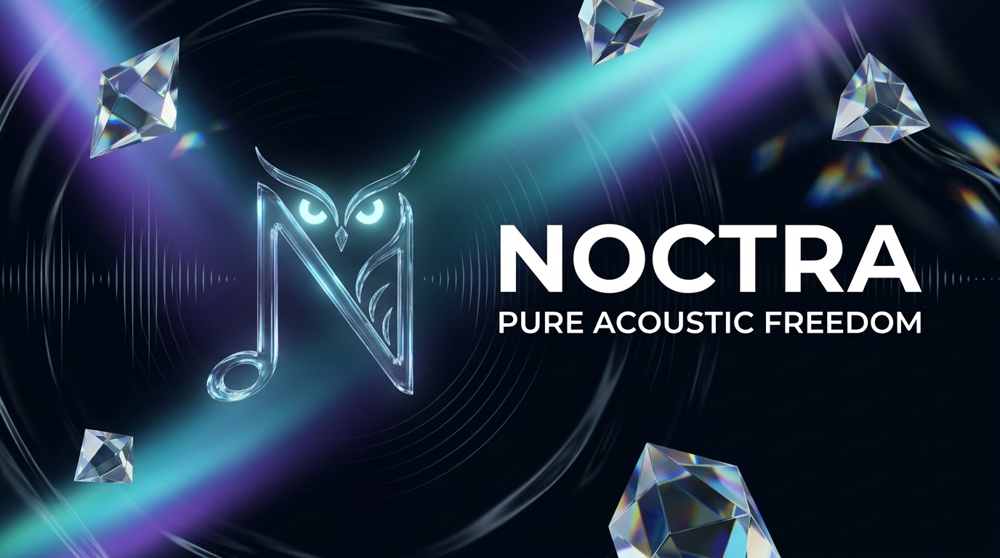
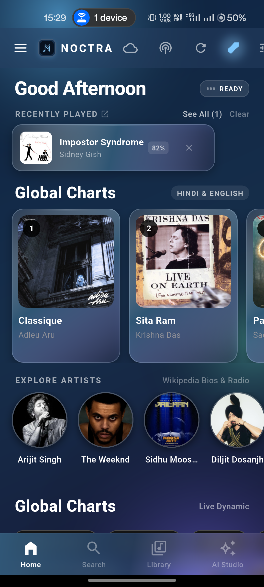
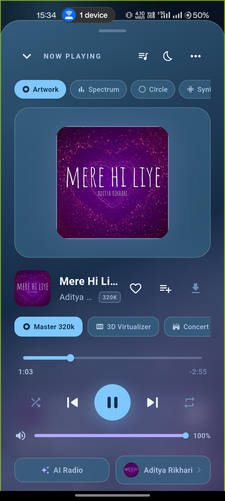
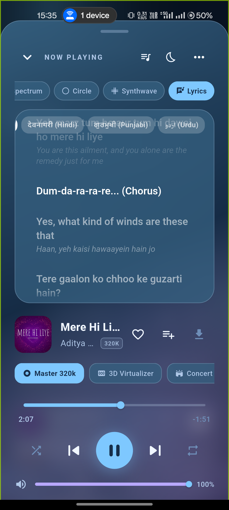
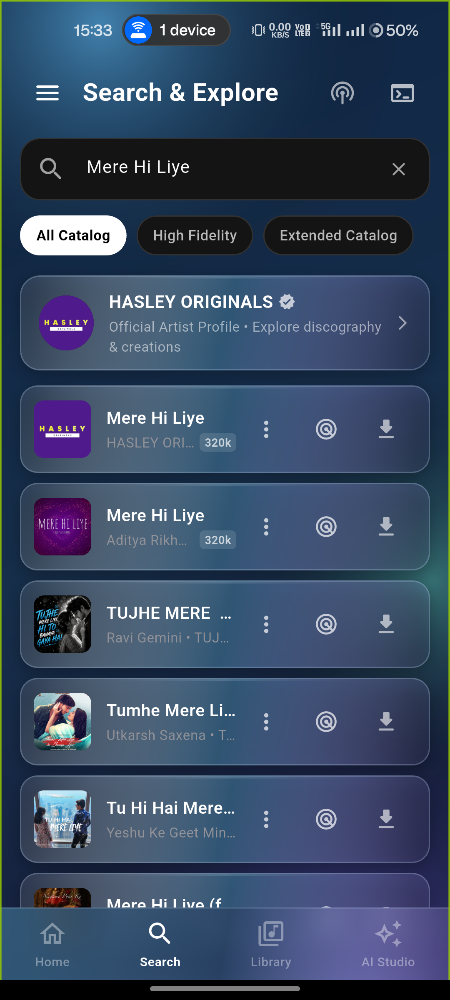
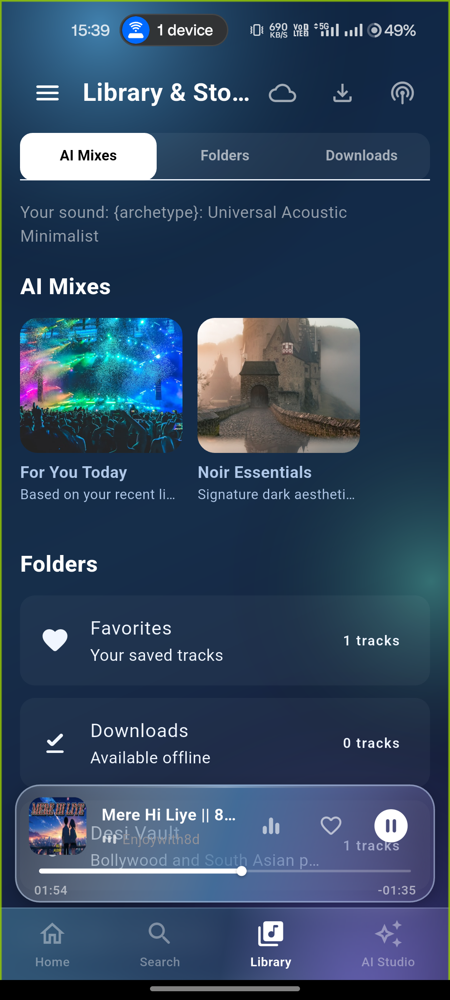
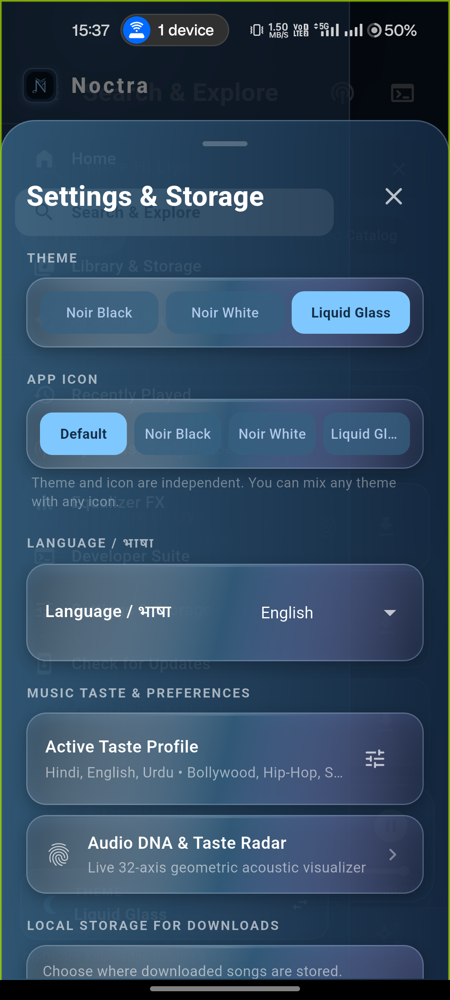

<p align="center">
  
</p>

<h1 align="center">Noctra</h1>

<p align="center">
  <b>Autonomous, Privacy-Sovereign, Audiophile-Grade Cross-Platform Music Client</b><br />
  Lossless 24-bit/192kHz playback &bull; Dual Glassmorphic themes &bull; Spotify recommendation graph &bull; Native Rust Core DSP &bull; Zero telemetry
</p>

<p align="center">
  <a href="https://github.com/Ansh22x/Noctra/releases/latest"></a>
  <a href="../LICENSE"></a>
  <a href="SECURITY.md"></a>
  <a href="#privacy-sovereignty"></a>
  <a href="#streaming--audiophile-playback"></a>
  <a href="../rust/noctra_core"></a>
  <a href="https://flutter.dev"></a>
</p>

<p align="center">
  <a href="https://noctra-audio.netlify.app/"><b>Official Website</b></a> &bull;
  <a href="https://github.com/Ansh22x/Noctra/releases/latest"><b>Downloads & Releases</b></a> &bull;
  <a href="../README.md"><b>Repository Root</b></a>
</p>

<p align="center">
  <a href="#overview">Overview</a> &bull;
  <a href="#screenshots">Screenshots</a> &bull;
  <a href="#key-features">Key Features</a> &bull;
  <a href="#installation--downloads">Downloads</a> &bull;
  <a href="#architecture">Architecture</a> &bull;
  <a href="#building-from-source">Build from Source</a> &bull;
  <a href="CHANGELOG.md">Changelog</a> &bull;
  <a href="#legal-disclaimer--terms-of-use">Legal Disclaimer</a>
</p>

---

## Overview

**Noctra** is an authentication-less, privacy-sovereign audiophile music streaming platform engineered for **Android, Windows, Linux, and iOS**.

Built with Flutter, Dart, Riverpod, and an embedded native **Rust Core Engine (`noctra_core`)**, Noctra streams pure lossless FLAC audio up to **24-bit/192 kHz**, reconstructs lossy audio to **24-bit studio WAVs** via on-device DSP upscaling, synchronizes bilingual lyrics with Apple Music-style translation subtitles, powers track exploration through **Spotify's official recommendation graph**, and packages into standalone installers without user accounts, cloud tracking, or telemetry.

---

## Screenshots

<table align="center">
  <tr>
    <td align="center" width="33%">
      <br />
      <b>Discovery & Spotify Feeds</b>
    </td>
    <td align="center" width="33%">
      <br />
      <b>Hi-Res Player & Audio Telemetry</b>
    </td>
    <td align="center" width="33%">
      <br />
      <b>Bilingual Lyrics & Subtitles</b>
    </td>
  </tr>
  <tr>
    <td align="center" width="33%">
      <br />
      <b>Search & Catalog Explorer</b>
    </td>
    <td align="center" width="33%">
      <br />
      <b>Library & Big Artwork Covers</b>
    </td>
    <td align="center" width="33%">
      <br />
      <b>DSP Equalizer & Settings</b>
    </td>
  </tr>
</table>

---

## Key Features

### 💎 Dual Glassmorphic Design System
- **Curated High-Contrast Aesthetics**: Strictly focused on two translucent dark/glass modes:
  - **Glassmorphic Black**: Deep obsidian noir canvas, frosted translucent surfaces, and crisp specular borders.
  - **Liquid Glass**: Translucent sapphire blur glassmorphism with dynamic specular highlights and cyan/violet accents.
- **Pure Dark Focus**: Eliminates jarring light-mode flashes with full zero-light consistency across desktop and mobile.
- **Dynamic Themed Launcher Icons**: Automatically updates the Android home launcher icon to reflect your active aesthetic.

### ⚡ Native Embedded Rust Core (`noctra_core`)
- **Zero-Copy In-Memory Dart FFI Bridge**: High-performance Rust dynamic library (`noctra_core.dll` / `libnoctra_core.so`) compiled directly for host hardware with seamless pure-Dart fallback.
- **Hardware-Accelerated Stream Decryption**: Bit-accurate DES ECB stream decryption for high-fidelity 320kbps audio.
- **24-Bit Studio Audio Upscaler**: High-frequency harmonic exciter and soft limiter generating bit-perfect 24-bit WAVs from compressed inputs.
- **Stem Separation & Radix-2 FFT**: In-place Cooley-Tukey FFT & IFFT with spectral band masking (Vocals, Bass, Drums, Instrumental, Karaoke).
- **Sub-Millisecond Multi-Script Transliteration**: Native Romanization for Korean Hangul, Cyrillic, Japanese Kana, and Indic Devanagari.

### 🎧 Spotify Recommendation Graph
- **Algorithmic Discovery without Bloat**: Powered by Spotify's official recommendation endpoints (`api.spotify.com/v1/recommendations`) via public web player tokens.
- **Seed-Based Radio & Vibe Mixes**: Generates dynamic track playlists based on any seed song, artist, genre, or mood.
- **Curated Fallback Charts**: Gracefully degrades to Spotify's curated genre charts and trending lists during offline or unauthenticated sessions.

### 📂 Revamped Sovereign Library
- **Fixed Downloads Folder**: Pinned permanently at index 0—all downloaded tracks save here automatically for one-tap offline access.
- **Fixed Favorites Folder**: Pinned at index 1 for instant access to loved tracks.
- **Big Artwork Covers**: Custom and imported playlist folders feature responsive high-resolution cover artwork:
  - 2×2 multi-track collage mosaics for playlists with $\ge 4$ tracks.
  - Full hero cover artwork for 1–3 tracks.
  - Specular glass badges for Downloads and Favorites.
- **Universal Playlist Import & Export**: 1-tap import from Spotify, YouTube, and plaintext tracklists, with lossless `.noctra.json` export.

### 📝 Synced Bilingual Lyrics & Transliteration
- **Consolidated Bilingual Subtitles**: Apple Music & Spotify-style merged dual-language LRC lines with synchronized translation subtitles.
- **Offline Phonetic Transliteration**: Synchronous transliteration supporting Devanagari, Gurmukhi, Urdu, Bengali, Tamil, Telugu, Kannada, Malayalam, Gujarati, Odia, and Romanized Latin.

### 🛡️ Privacy Sovereignty & Zero Telemetry
- **No User Accounts**: Never requires login, phone number, email, or credential tokens.
- **100% Serverless Architecture**: Zero remote servers, zero user profiling, zero analytics SDKs, and zero tracking cookies.

---

## Installation & Downloads

Pre-compiled production binaries for all supported platforms are available on the [**Releases Page**](https://github.com/Ansh22x/Noctra/releases/latest):

| Operating System | Package Name | Target Architecture | Installation Guide |
|---|---|---|---|
| **Android (64-bit)** | `Noctra-1.0.2-arm64-v8a.apk` | ARM64 | **Recommended for modern phones & tablets.** Smallest download. |
| **Android (32-bit)** | `Noctra-1.0.2-armeabi-v7a.apk` | ARMv7 | Legacy 32-bit Android devices only. |
| **Android (x86_64)** | `Noctra-1.0.2-x86_64.apk` | x86_64 | Android emulators, ChromeOS, Windows Subsystem for Android. |
| **Android (Universal)** | `Noctra-1.0.2-universal.apk` | All ABIs | One file that runs on any Android 8.0+ device. |
| **Windows** | `Noctra-1.0.2-Setup-x64.exe` | x86_64 / x64 | Run installer &bull; Installs to `AppData` with Desktop shortcut. |
| **Linux** | `noctra_1.0.2_amd64.deb` | x86_64 / amd64 | Run `sudo dpkg -i noctra_1.0.2_amd64.deb`. |
| **iOS** | `Noctra-1.0.2.ipa` | ARM64 | Sideload via [AltStore](https://altstore.io/), [SideStore](https://sidestore.io/), or [TrollStore](https://github.com/opa334/TrollStore). |

> **Package Verification**: Every release includes `SHA256SUMS.txt` (all artifacts) and `noctra-update-manifest.json` (per-ABI pinned digests). Verify your download using `sha256sum -c SHA256SUMS.txt --ignore-missing`.

---

## Architecture & Documentation

All technical documentation, guides, and specifications reside in this directory:

| Document | Description |
|---|---|
| [**Architecture Overview**](ARCHITECTURE.md) | High-level system design, modular boundaries (≤300 LOC rule), and data flows |
| [**Rust Core Engine**](RUST_CORE.md) | Native DSP algorithms, FFT stem separation, FFI bindings, and Axum endpoints |
| [**Design System & Themes**](DESIGN_SYSTEM.md) | Glassmorphic Black & Liquid Glass tokens, blur sigmas, and contrast curves |
| [**Implementation Status**](IMPLEMENTATION_STATUS.md) | Detailed feature verification and test matrices |
| [**Platform Guides**](PLATFORM.md) | OS-specific setup, packaging scripts, and Android ABI management |
| [**Changelog**](CHANGELOG.md) | Full release history and change notes |
| [**Contributing Guide**](CONTRIBUTING.md) | Guidelines for contributing code, tests, and documentation |
| [**Security Policy**](SECURITY.md) | Vulnerability disclosure and privacy verification practices |

---

## Building from Source

### Prerequisites
- [Flutter SDK](https://flutter.dev/docs/get-started/install) (`>= 3.24.0` / Stable channel)
- Java JDK 17
- [Rust & Cargo](https://rustup.rs/) (`>= 1.78.0`)
- Platform Toolchains (Android SDK 36, Visual Studio 2022 C++, or Linux build-essential)

### 1. Clone & Fetch Dependencies
```bash
git clone https://github.com/Ansh22x/Noctra.git
cd Noctra
flutter pub get
```

### 2. Build the Native Rust Core (Optional for Desktop FFI)
```bash
cd rust/noctra_core
cargo build --release
cd ../..
```

### 3. Run Tests
```bash
# Rust core unit tests
cargo test --manifest-path rust/noctra_core/Cargo.toml

# Flutter unit and widget tests
flutter test
```

### 4. Build Application
```bash
# Android Universal APK
flutter build apk --release

# Android Split-ABI APKs
flutter build apk --release --split-per-abi

# Windows Desktop
flutter build windows --release

# Linux Desktop
flutter build linux --release
```

---

## Development Team

| Role | Developer |
|---|---|
| **Maintainer / Owner** | [**Ansh22x**](https://github.com/Ansh22x) |
| **Developer** | [**GuruMachanica**](https://github.com/GuruMachanica) |

---

## Special Thanks

Noctra stands on the shoulders of remarkable open-source projects:

- [**Flutter**](https://flutter.dev) & [**Riverpod**](https://riverpod.dev) — Cross-platform reactive UI framework & state management.
- [**just_audio**](https://github.com/ryanheise/just_audio) — Robust audio playback engine by Ryan Heise.
- [**LRCLIB**](https://lrclib.net) — Community-driven synchronized lyrics database.
- [**indic_transliteration**](https://github.com/sanskrit-coders/indic_transliteration_dart) — Indic script transliteration matrices.
- [**Inno Setup**](https://jrsoftware.org/isinfo.php) — Professional Windows single-file installer packager.

---

## Legal Disclaimer & Terms of Use

1. **100% Free & Strictly Non-Commercial**: Noctra is a free open-source software (FOSS) project licensed under the **GNU General Public License v3.0**. It contains no advertisements, subscriptions, paid tiers, or monetization.
2. **Third-Party Client**: Noctra acts exclusively as an optimized media client and parser for publicly available endpoints. It is comparable to a privacy-focused web browser.
3. **No Hosting of Copyrighted Material**: Noctra does not host, cache, or distribute copyright-protected audio or video files. All streams originate directly from public third-party endpoints.
4. **Support Artists**: We strongly encourage users to support their favorite musicians by subscribing to official channels, attending concerts, and buying music on official platforms.

---

<p align="center">
  Licensed under <a href="../LICENSE">GPL-3.0</a> &bull; Crafted with precision for acoustic sovereignty.
</p>
